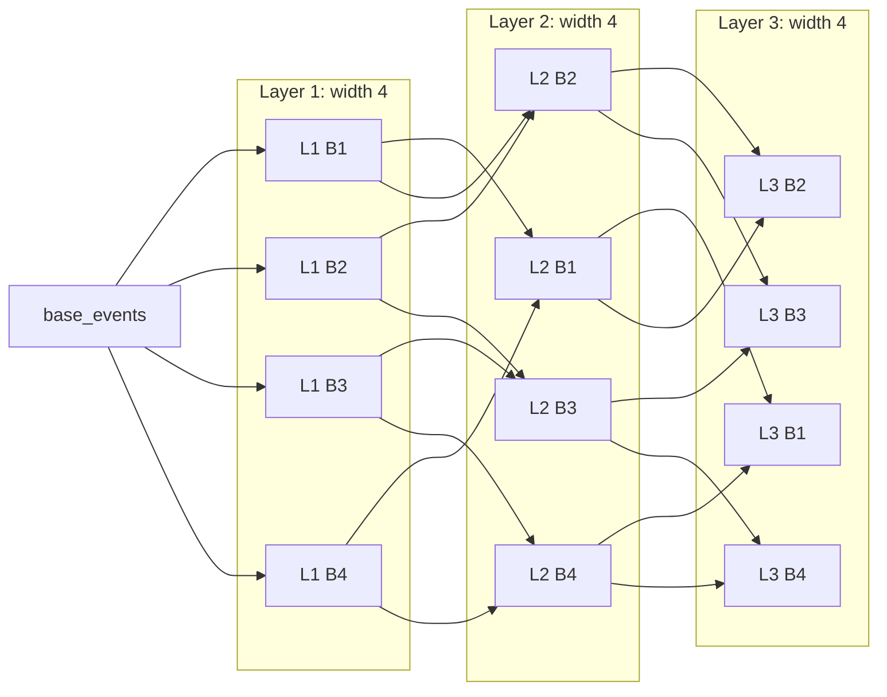

# dbt Core vs. dbt Fusion benchmark

This project compares the wall-clock performance of dbt Core and dbt Fusion on the same synthetic DuckDB project. It exercises three different stages of dbt's work:

- `dbt parse`: read project files, parse Jinja/YAML, and construct the manifest/DAG.
- `dbt compile`: parse the project and render executable SQL, without running the models.
- `dbt build`: parse, compile, execute every model, materialize tables, and run data tests.

The project is deliberately configurable. Model count, graph depth, graph width, SQL expression count, test count, and source row count can be changed independently to test different kinds of load.

The installed environments used when this README was written were:

- dbt Core `1.12.0` with `dbt-duckdb` `1.10.1` in `.venv-core`.
- dbt Fusion `2.0.0-preview.202` in `.venv-fusion`.

## Project layout

| Path | Purpose |
|---|---|
| `dbt_project.yml` | Defines the `fusion_benchmark` project and table materialization default. |
| `profiles.yml` | Configures a four-thread DuckDB target. |
| `models/base_events.sql` | Generates deterministic synthetic input rows. |
| `models/generated/` | Contains the generated SQL models and test YAML. Do not edit these by hand. |
| `macros/synthetic_columns.sql` | Emits the configurable calculated columns in every generated model. |
| `scripts/generate_models.py` | Recreates the generated model DAG. |
| `scripts/run_benchmark_*.ps1` | Runs paired Core/Fusion benchmarks and writes CSV results. |
| `benchmark_results/` | Archived timestamped measurements. |
| `warehouse/` | Disposable DuckDB database files created by build runs. |
| `target/` and `logs/` | dbt artifacts and logs; not benchmark inputs. |

## How the synthetic data is built

`models/base_events.sql` uses DuckDB's `range()` function to create rows numbered from `0` through `rows - 1`. No external source data is required.

Each row deterministically contains:

- an `id`;
- customer, product, and customer-group IDs calculated with modulo arithmetic;
- one of four countries (`DE`, `FR`, `NL`, or `AT`);
- a repeatable decimal amount; and
- a timestamp offset from `2025-01-01`.

For example, the first few rows of `base_events` look like this:

| id | customer_id | product_id | customer_group | country | amount | event_timestamp |
|---:|---:|---:|---:|---|---:|---|
| 0 | 0 | 0 | 0 | DE | 0.00 | 2025-01-01 00:00:00 |
| 1 | 1 | 1 | 1 | FR | 0.01 | 2025-01-01 00:00:01 |
| 2 | 2 | 2 | 2 | NL | 0.02 | 2025-01-01 00:00:02 |
| 3 | 3 | 3 | 3 | AT | 0.03 | 2025-01-01 00:00:03 |
| 4 | 4 | 4 | 4 | DE | 0.04 | 2025-01-01 00:00:04 |
| 100 | 100 | 100 | 0 | DE | 1.00 | 2025-01-01 00:01:40 |

The values repeat in controlled cycles. For example, `customer_group` repeats every 100 IDs, `product_id` every 1,000, and `customer_id` and `amount` every 10,000. This creates predictable groups large enough for joins, aggregations, and window functions without needing a source system.

### What happens to a row downstream

The generated models keep the seven base columns and enrich each row. A generated row also receives:

| Added value | Example meaning |
|---|---|
| `group_event_count` | Number of rows in the same `customer_group` in the secondary parent model |
| `group_average_amount` | Average amount for that group |
| `group_row_number` | This event's ordered position within its group |
| `previous_amount` | Previous amount for the same customer, or `null` for the first event |
| `rolling_average_amount` | Average of this row and up to 10 preceding rows in the group |
| `record_hash` | MD5 of the row ID plus the current layer and branch |
| `calculated_value_001` through `030` | Arithmetic columns emitted by the macro in the current project |

For example, `model_l001_b001` takes the base rows as its primary input, separately summarizes the base rows by `customer_group`, joins those summaries back to every event, and calculates the window, hash, and synthetic columns. The next layer repeats that work using generated tables as its inputs.

## How the model DAG is intertwined

### First, the terminology

A dbt DAG is a map of models and their dependencies. An arrow from model A to model B means B uses `ref('A')`, so A must be ready before B can run.

| Term | Meaning in this project | Mental picture |
|---|---|---|
| **Layer** | One horizontal step away from `base_events` | A row of models |
| **Width** | Number of models in every layer | How many models sit side by side in each row |
| **Branch** | A model's numbered position within a layer | A mostly vertical lane through the graph |
| **Fan-in** | One model depends on multiple parents | Two arrows entering a model |
| **Fan-out** | One model feeds multiple children | Two arrows leaving a model |

Depth and width describe different kinds of scale:

- Increasing **layers** makes dependency chains longer. Later layers must wait for earlier layers.
- Increasing **width** adds more models that may be eligible to run alongside one another, subject to dependencies and the four-thread profile.
- Increasing **branch count** is the same as increasing **width** in this generator; each extra branch adds one model to every layer.

### A small example you can visualize

Imagine generating only three layers at width four:

```powershell
python .\scripts\generate_models.py --layers 3 --width 4 --expressions 2 --test-every 0
```

This creates 12 generated models plus `base_events`. Read the graph from left to right:



`L2 B2`, for example, means layer 2, branch 2. It uses:

- `L1 B2` as its primary row source; and
- `L1 B1`, the previous branch, for grouped statistics.

### How the two fan-in branches are chosen

For a model in layer 2 or later, the generator does not choose parents randomly. It always applies this rule:

```text
primary parent branch   = current branch
secondary parent branch = current branch - 1
```

## Workload controls

Regenerate the project from the repository root:

```powershell
python .\scripts\generate_models.py `
    --layers 50 `
    --width 20 `
    --expressions 30 `
    --test-every 5
```

| Argument | Default | Effect |
|---|---:|---|
| `--layers` | 5 | Number of dependency levels. Must be at least 1. |
| `--width` | 4 | Models per level. Must be at least 1. |
| `--expressions` | 10 | Calculated columns emitted per generated model. Must be at least 1. |
| `--test-every` | 5 | Add two tests to every Nth model; use `0` to disable tests. |

Useful formulas are:

$$
\text{generated models} = \text{layers} \times \text{width}
$$

$$
\text{total models} = 1 + (\text{layers} \times \text{width})
$$

$$
\text{tests} = 2 \times \left\lfloor\frac{\text{layers} \times \text{width}}{\text{test-every}}\right\rfloor
$$

The last formula applies when `test-every` is greater than zero.

The generator deletes and recreates `models/generated/`. Regenerating the project changes the workload represented by every subsequent result, so record the generator arguments with each experiment.

To change execution volume or repetitions, edit these values near the top of each benchmark script:

```powershell
$rows = 1000000
$runs = 5
```

## Running the benchmark

Run all commands from the repository root in PowerShell.

### 1. Verify both engines

```powershell
.\.venv-core\Scripts\dbt.exe --version
.\.venv-fusion\Scripts\dbt.exe --version
```

The scripts expect those exact virtual-environment paths. This repository contains the environments but does not contain lock files or installation scripts from which to recreate them. If they are absent, install compatible dbt Core + DuckDB and dbt Fusion environments, then preserve the executable paths expected by the scripts or update `$coreDbt` and `$fusionDbt`.

### 2. Generate a known workload

```powershell
python .\scripts\generate_models.py `
    --layers 50 `
    --width 20 `
    --expressions 30 `
    --test-every 5
```

The generator prints the resulting model counts. Save that output with the benchmark results when reproducibility matters.

### 3. Run the desired measurements

```powershell
.\scripts\run_benchmark_parse.ps1
.\scripts\run_benchmark_compile.ps1
.\scripts\run_benchmark_build.ps1
```

Run one script at a time and avoid other CPU-, memory-, or disk-intensive work during measurement. `build` can be expensive at the current scale; start with fewer rows or a smaller graph when validating a new environment.

## What the runners do and how does it generate a test result.

All three scripts use the same comparison protocol:

1. Run five repetitions by default.
2. Run both engines once in each repetition.
3. Alternate execution order: Core then Fusion on odd repetitions, Fusion then Core on even repetitions.
4. Set a separate DuckDB path for each engine and repetition.
5. Remove that database before invoking dbt.
6. disable partial parsing with `--no-partial-parse`.
7. Time the complete CLI process with PowerShell `Measure-Command`.
8. Write one timestamped CSV after all repetitions finish.

Alternating order reduces systematic bias from always running one engine first. Separate, newly removed database files prevent Core and Fusion from sharing materialized tables.

### Parse

`run_benchmark_parse.ps1` invokes `dbt parse`. It primarily measures project discovery, SQL/YAML parsing, Jinja processing required for parsing, dependency extraction, and manifest construction. It does not compile all executable SQL or run models.

Use this result to discuss frontend/project-processing overhead on a large file and DAG count. Do not use it to claim query-execution improvements.

### Compile

`run_benchmark_compile.ps1` invokes `dbt compile`. It includes parsing and rendering model SQL but does not execute the model queries.

Use this result to discuss the time needed to turn a project into compiled SQL. Model count and expression count matter; row count is not an execution workload here.

### Build

`run_benchmark_build.ps1` invokes `dbt build`. It includes parsing, compilation, DuckDB startup, SQL execution, table creation, and data-test execution.

Use this as the end-to-end result. The gap between engines will usually be smaller than in parse or compile when DuckDB query execution dominates total time.

## Result files

Each run creates one of:

```text
benchmark_results/parse_YYYYMMDD_HHMMSS.csv
benchmark_results/compile_YYYYMMDD_HHMMSS.csv
benchmark_results/build_YYYYMMDD_HHMMSS.csv
```

The schema is:

| Column | Meaning |
|---|---|
| `Engine` | `core` or `fusion` |
| `Run` | Paired repetition number |
| `Rows` | Value passed as the `rows` dbt variable |
| `Seconds` | End-to-end wall-clock seconds measured around the dbt process |

Files containing `_cold_startN` were manually renamed or produced by an older workflow: the current scripts do not add that suffix. Treat it only as a historical label unless the exact cache-reset procedure is known.

The archive contains results at 1,000, 10,000, 100,000, and 1,000,000 rows. The CSV does **not** record layers, width, expression count, test frequency, dbt versions, hardware, or git revision. Archived files are therefore not automatically comparable just because their `Rows` values match.

## Interpreting a comparison

Compare Core and Fusion within the same CSV. Prefer the median across repetitions because it is less sensitive to startup noise than a single run or the mean.

For example, `benchmark_results/compile_20260802_143647.csv` has these medians:

| Engine | Median | Minimum | Maximum |
|---|---:|---:|---:|
| Core | 6.140 s | 6.054 s | 6.200 s |
| Fusion | 1.031 s | 0.930 s | 1.237 s |

The median compile speedup is $6.140 / 1.031 = 5.96\times$. This supports the narrow statement: **Fusion compiled this generated project about 5.96 times faster than Core in that five-repetition run.** It does not establish the same speedup for builds, other adapters, other project shapes, or other machines.

## Fair-test checklist

For a result that can be explained and repeated, record:

- dbt Core, adapter, and Fusion versions;
- generator arguments: layers, width, expressions, and test frequency;
- row count and repetition count;
- command type: parse, compile, or build;
- whether the run was intended to be cold or warm and exactly what was cleared;
- the result CSV and any failures shown in the terminal;

Keep these fixed when comparing engines. Change one workload dimension at a time when studying scaling. Good experiment series include:

- increase `--layers` while holding width and expressions fixed to study DAG depth;
- increase `--width` while holding layers fixed to study graph breadth;
- increase `--expressions` to study Jinja and SQL compilation complexity;
- increase `$rows` only for `build` to study database execution volume; and
- vary the profile's `threads` setting in a separate series to study concurrency. (This remained at 4 threads for my tests.)

## Limitations

- This is a synthetic benchmark, not a representative production project.
- DuckDB is embedded and local; results do not generalize directly to networked warehouses.
- `Measure-Command` includes process startup and all CLI overhead, which is intentional but should be stated.
- Partial parsing is disabled, so the benchmark measures full project processing rather than iterative developer workflows that reuse parse artifacts.
- Each generated model is a table and repeats expensive windows, aggregation, joining, hashing, and calculated columns. This is intentionally heavier than many real models.
- The four-thread setting and machine resources constrain build parallelism.
- Existing CSVs lack complete workload metadata, so compare historical files only when their surrounding experimental setup is known.
- The current build runner explicitly throws on a failed dbt command. The parse and compile runners do not perform the same explicit exit-code check, so inspect terminal output and logs before accepting those CSVs.
